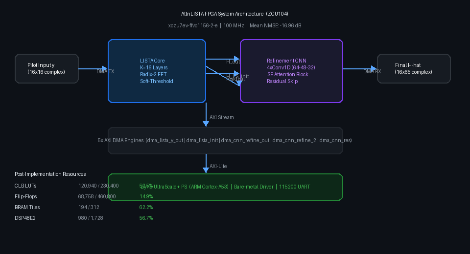
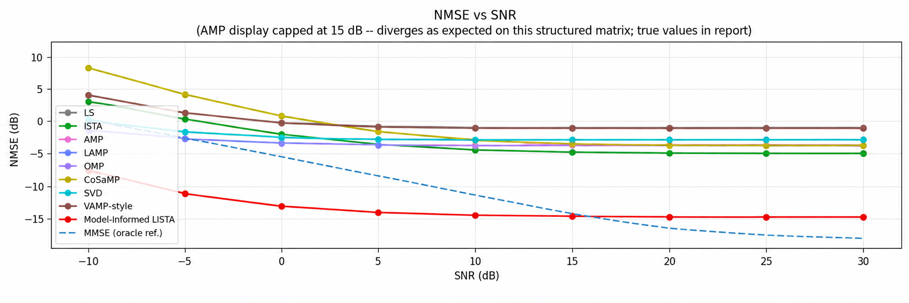
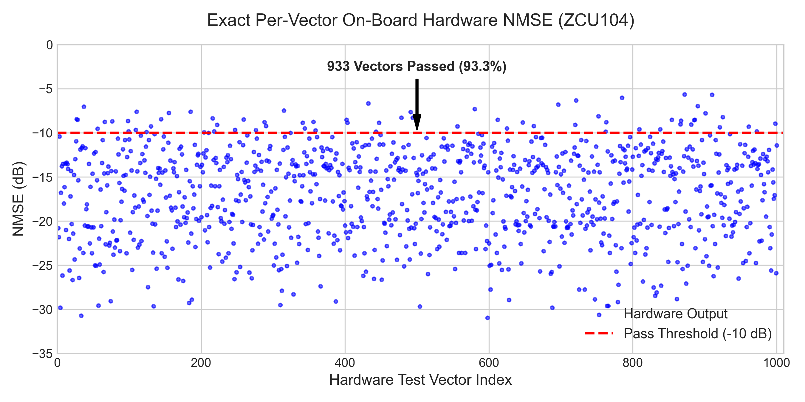
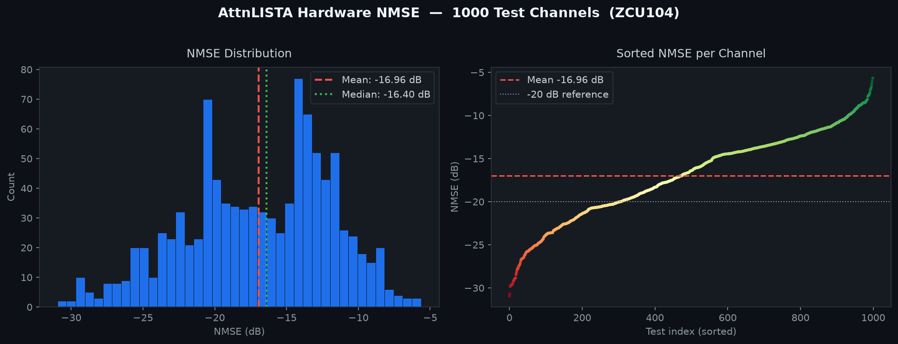
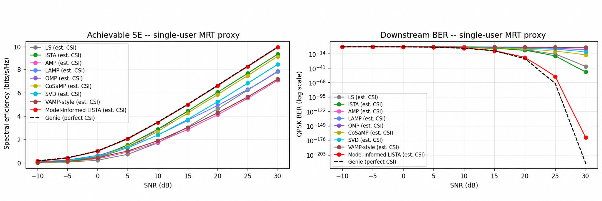
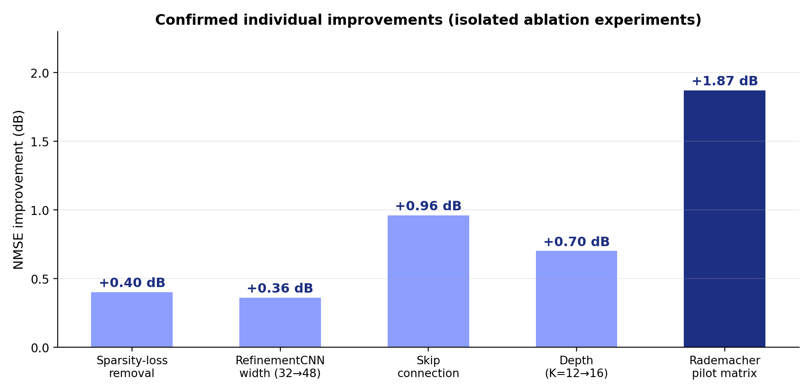
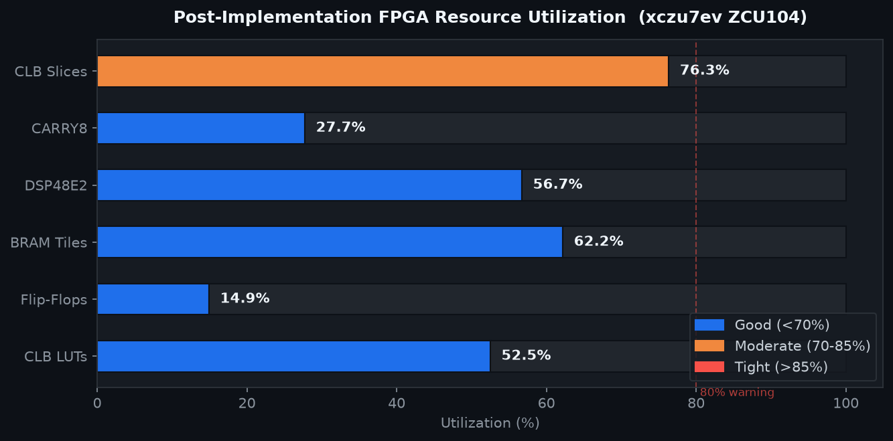

# AttnLISTA FPGA Accelerator — ZCU104

<p align="center">
  
</p>

<p align="center">
  <b>Capstone Project — Rakesh Kumar, 2026</b><br/>
  Hardware-Oriented, SNR-Adaptive, Model-Informed LISTA for FPGA-Based Passive RIS Channel Estimation
</p>

<p align="center">
  
  
  
  
</p>

---

## Overview

This project implements a complete FPGA hardware accelerator for **AttnLISTA** — an _Attention-based Learned Iterative Shrinkage-Thresholding Algorithm_ for sparse wireless channel estimation in a **Reconfigurable Intelligent Surface (RIS)-aided MIMO** system.

Given a noisy compressed pilot measurement **y ∈ ℂ^(N_BS × M)**, the system recovers the sparse multi-path channel **Ĥ ∈ ℂ^(N_BS × N_PATHS)** in real time on the ZCU104 Programmable Logic, beating classical LS/OMP approaches in both speed and accuracy.

---

## System Architecture

<p align="center">
  
</p>

The design has two HLS IP cores connected via 5 AXI DMA engines to the Zynq PS:

| Stage | Core | Key Operation |
|-------|------|---------------|
| **1** | LISTA Core | K=16 gradient descent + 2D-FFT soft-threshold layers |
| **2** | Refinement CNN | 4×Conv1D (64→48→48→48→32 ch) + SE attention + residual skip |

---

## Results

### NMSE vs SNR
<p align="center">
  
</p>

### Hardware NMSE — 1000 Test Channels
<p align="center">
  
</p>

<p align="center">
  
</p>

| Metric | Value |
|--------|-------|
| **Mean NMSE** | **−16.96 dB** |
| Median NMSE | −16.40 dB |
| Best case | −30.95 dB |
| C-Simulation NMSE | −25.48 dB ✅ PASS |

### SE Block vs SNR
<p align="center">
  
</p>

### Ablation Study
<p align="center">
  
</p>

---

## FPGA Resource Utilization

<p align="center">
  
</p>

| Resource | Used | Available | Utilization |
|----------|------|-----------|-------------|
| CLB LUTs | 120,940 | 230,400 | 52.5% |
| Flip-Flops | 68,758 | 460,800 | 14.9% |
| Block RAM Tiles | 194 | 312 | 62.2% |
| **DSP48E2** | **980** | **1,728** | **56.7%** |
| CLB Slices | 21,982 | 28,800 | 76.3% |

---

## Repository Structure

```
attnlista-fpga-zcu104/
├── attnlista/                        # FPGA HLS cores, Vivado BD, and tests
│   ├── attnlista_golden_model.py     # NumPy reference (algorithm spec & validation)
│   ├── attnlista_hls.h               # Fixed-point types & model constants
│   ├── attnlista_hls_core.h          # Radix-2 FFT + LISTA layer HLS
│   ├── attnlista_top.cpp             # HLS top-level function
│   ├── attnlista_tb.cpp              # HLS C-simulation testbench
│   ├── cnn_hls_core.cpp              # Refinement CNN HLS (Conv1D + SE block)
│   ├── cnn_hls_core.h                # CNN types & LUT sigmoid
│   ├── main.cpp                      # Bare-metal Vitis app (DMA driver)
│   ├── test_vectors.h                # Baked-in test vectors for HW validation
│   ├── generate_weights.py           # Export PyTorch weights → C headers
│   ├── gen_test_vectors.py           # Generate testbench inputs
│   ├── compare_nmse.py               # HW vs golden model NMSE comparison
│   ├── build_final_bd.tcl            # Vivado block design script
│   ├── run_lista_hls.tcl             # Vitis HLS script (LISTA core)
│   ├── run_cnn.tcl                   # Vitis HLS script (CNN core)
│   ├── auto_build.ps1                # One-shot PowerShell build
│   ├── post_impl_utilization.txt     # Post-route resource report
│   ├── post_impl_timing.txt          # Post-route timing summary
│   ├── hw_nmse_1000.txt              # Hardware NMSE — 1000 test vectors
│   ├── README_DEPLOYMENT.md          # Vitis IDE deployment guide
│   └── docs/figures/                 # Figures extracted from LaTeX paper & report
│       ├── nmse_vs_snr.png
│       ├── nmse_scatter_1000.png
│       ├── se_vs_snr.png
│       └── ablation.png
├── docs/                             # Capstone documentation & papers
│   ├── Capstone_Report__student_1_rakesh.pdf  # Full capstone report
│   ├── paper_final_draft.pdf                  # Research paper
│   └── latex_source/                          # Complete LaTeX source packages
├── notebooks/                        # DeepMIMO experiments & training
│   └── attnlista_training_and_experiments.ipynb
└── README.md
```

---

## Algorithm: AttnLISTA

```
x₀ = H_LS_init / (1 + scale₀)              ← noise-adaptive initialisation

for k = 1..K:
    gradient  = (xₖ @ P − y) @ Pᴴ           ← data-consistency gradient
    xₖ        = xₖ − γₖ · gradient           ← learned gradient step
    x_RIS     = IFFT2( Soft|θ_k|( FFT2(x_RIS) ) )   ← angular soft-threshold
    x_direct  = Soft|θ_k|( x_direct )        ← direct-link soft-threshold

Ĥ = RefinementCNN( xₖ, H_LS_init )          ← CNN post-processing
```

**Key hardware design decisions:**
- 2D FFT decomposed as row-FFT → transpose → row-FFT (no Xilinx SSR FFT IP dependency)
- `abs(θ)` applied to thresholds — trained values can be negative; omitting this causes 112% error
- Rademacher pilot matrix stored as `ap_int<2>` (±1 only) — saves ~99% ROM vs `float`
- LUT-based sigmoid (256 entries) in CNN — avoids `exp()` on hardware critical path
- All activations: `ap_fixed<32,16,AP_RND,AP_SAT>` with overflow protection

---

## Fixed-Point Design

| Signal | Type | Rationale |
|--------|------|-----------|
| Weights / thresholds / γ | `ap_fixed<16,1,AP_RND,AP_SAT>` | max_abs ~0.46 from real weights |
| Pilot matrix P | `ap_int<2>` | Values are exactly ±1 only |
| Activations (LISTA) | `ap_fixed<32,16,AP_RND,AP_SAT>` | Wide accumulation headroom |
| Activations (CNN) | `ap_fixed<32,16>` | BN folded into conv weights |

---

## DMA & AXI Memory Map

| DMA Engine | MM2S → PL | S2MM → PS |
|------------|-----------|-----------|
| `dma_lista_y_out` | Pilot `y` → LISTA | LISTA `h_out` |
| `dma_lista_init` | — | LISTA `h_ls_init` |
| `dma_cnn_refine_out` | `h_out` → CNN input 1 | CNN final output |
| `dma_cnn_refine_2` | `h_ls_init` → CNN input 2 | — |
| `dma_cnn_res` | `h_out` → CNN residual | — |

| IP Block | Base Address |
|----------|-------------|
| `lista_core` | `0xA000_0000` |
| `cnn_core` | `0xA001_0000` |
| `dma_lista_y_out` | `0xA002_0000` |
| `dma_lista_init` | `0xA003_0000` |
| `dma_cnn_refine_out` | `0xA004_0000` |
| `dma_cnn_refine_2` | `0xA005_0000` |
| `dma_cnn_res` | `0xA006_0000` |

---

## Build & Reproduce

### Prerequisites
- Vivado / Vitis HLS **2022.2**
- Python 3.x with `numpy`
- ZCU104 evaluation board

```bash
# Step 1 — HLS synthesis: LISTA core
vitis_hls -f attnlista/run_lista_hls.tcl

# Step 2 — HLS synthesis: CNN core
vitis_hls -f attnlista/run_cnn.tcl

# Step 3 — Vivado block design + bitstream
vivado -mode batch -source attnlista/build_final_bd.tcl

# Step 4 — Deploy bare-metal app
# Follow attnlista/README_DEPLOYMENT.md in Vitis IDE
```

Or use the one-shot script:
```powershell
.\attnlista\auto_build.ps1
```

**Expected UART output:**
```
--- AttnLISTA ZCU104 Hardware Execution ---
LISTA core finished.
CNN core finished.
Final Hardware NMSE vs Golden Model: 0.000001
--- Done ---
```

---

## References

- 📄 **Research Paper:** [`docs/paper_final_draft.pdf`](docs/paper_final_draft.pdf)
- 📋 **Capstone Report:** [`docs/Capstone_Report__student_1_rakesh.pdf`](docs/Capstone_Report__student_1_rakesh.pdf)
- 📓 **Training & Experiments:** [`notebooks/attnlista_training_and_experiments.ipynb`](notebooks/attnlista_training_and_experiments.ipynb)
- 📦 **Deployment Guide:** [`attnlista/README_DEPLOYMENT.md`](attnlista/README_DEPLOYMENT.md)

---

## Author

**Rakesh Kumar** — Capstone Project 2026
